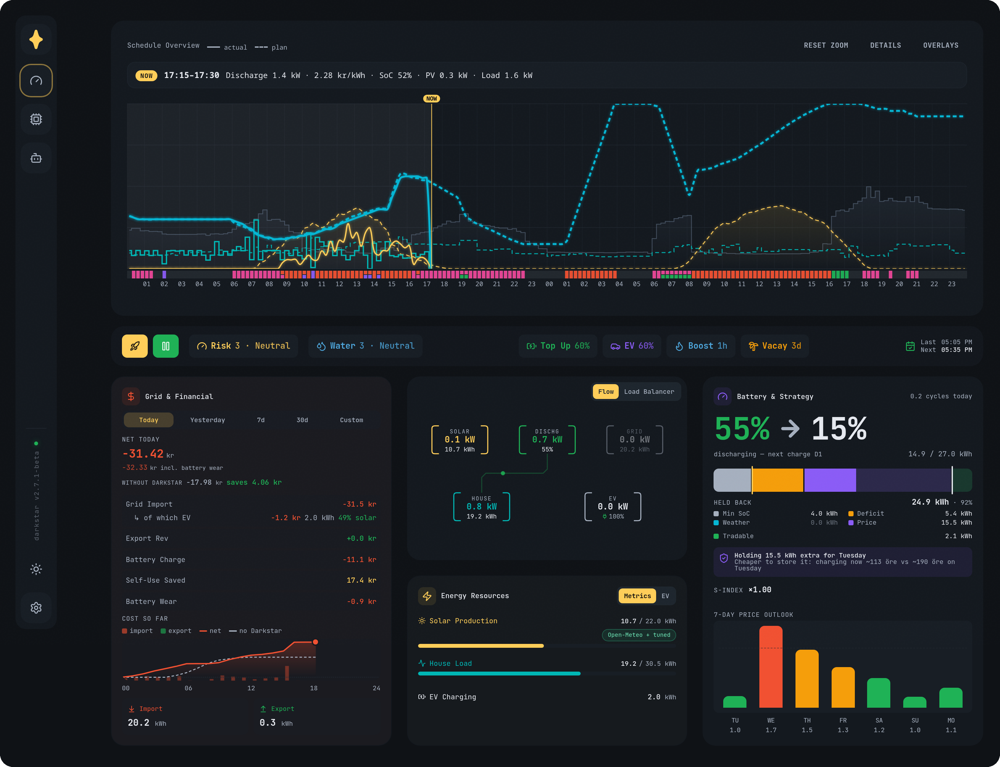

    
     
     
    <h3>Cut your electricity bill. Let Darkstar optimize your battery, solar, EV and water heater!</h3>
    
    
    

 

Darkstar runs next to Home Assistant and decides when your battery should charge, discharge or sit idle, based on electricity prices, the weather and how your home actually uses energy. It also plans your EV and water heater, so the cheap hours are put to work for you.

> [!WARNING]
> **Use at your own risk.** Darkstar controls high-power electrical equipment. Keep your Home Assistant safety cut-offs configured, check on it regularly and use it at your own risk. Savings depend on your prices, hardware and usage, and Darkstar does not guarantee any financial outcome. Not sure yet? Start in **shadow mode**, where Darkstar plans but doesn't control anything.

## Why Darkstar

- **Saves money on autopilot.** It charges when electricity is cheap, uses the battery when it's expensive and holds back energy before expensive days.
- **See what it saves.** The dashboard compares your real cost with a plain self-use inverter, so the saving isn't a guess.
- **Your EV is ready when you need it.** Say "80% by 07:00" and Darkstar finds the cheapest way there, with surplus solar first.
- **One brain for everything.** Battery, solar, EV and water heater are planned together, and your main fuse is protected.
- **Local and private.** It runs on your own hardware with no cloud account or subscription. Your energy history stays at home.
- **Learns your home.** Forecasts for your load, solar and prices improve over time, with no manual tuning.

## Works with

| Inverter | Status |
| --- | --- |
| Deye, SunSynk, Sol-Ark, Turbo Energy | Tested |
| Fronius GEN24 | Tested |
| Sungrow | Tested |
| Other brands | Community-mapped / Generic profile, entities mapped by hand |

- **Electricity prices**: Nord Pool, Swedish price areas SE1-SE4 only.
- **Region**: Darkstar supports Sweden only (Nord Pool price areas SE1, SE2, SE3 and SE4). Other countries and price areas are not supported.
- **Home Assistant**: Add-on or Docker.
- **EV chargers and water heaters**: Anything controllable from Home Assistant.

More inverters are coming. Missing yours? Ask on [Discord](https://discord.gg/SFnJf4NnMM) or see the [profile creation guide](docs/inverter-profiles/CREATING_INVERTER_PROFILES.md).

## Install

### Home Assistant Add-on (recommended)

1. Add the repository to Home Assistant:
   
2. Install **Darkstar Energy Manager** and start it. It connects to Home Assistant automatically.
3. Click **Open Web UI**. The setup wizard walks you through the rest.

Want the newest features? Install **[DEV] Darkstar Energy Manager** from the same repository. It updates often. Run only one of the two add-ons at a time: both publish host port 5000 and share `/config/darkstar` and `/share/darkstar`.

### Docker

1. Clone the repository and enter it: `git clone https://github.com/ergetie/darkstar.git && cd darkstar`.
2. Create your config files: `cp config.default.yaml config.yaml` and `cp secrets.example.yaml secrets.yaml`.
3. In Home Assistant, create a long-lived access token: open your profile, go to **Security**, scroll to **Long-lived access tokens** and click **Create token**. Copy it when it is shown, as it cannot be displayed again. Enter your Home Assistant URL and the token in `secrets.yaml`, or leave them as they are and enter both in the setup wizard's Connect step.
4. Run `docker compose up -d --build`. The image is built locally from the repository, which takes a few minutes the first time.
5. Open **http://localhost:5000** and follow the setup wizard.

A Raspberry Pi 4 or newer is recommended (Pi 5 preferred).

## Installation statistics

Darkstar sends one small anonymous heartbeat per day to `telemetry.wxl.se`. It contains a random installation ID, the Darkstar version, release channel, installation type, CPU architecture, inverter profile and executor mode (shadow, live or unknown). Energy data, location, entity names, credentials and detailed configuration are never sent, and the receiver does not keep IP addresses. Reporting is on by default. Turn it off at any time in **Settings -> System -> Installation statistics** (switch **Report installation statistics** off), or set `installation_stats.enabled: false` in `config.yaml`. In the setup wizard it can also be switched off on the last step.

See the [telemetry receiver README](telemetry_receiver/README.md) for details.

## Learn more

- **[Configuration Guide](docs/SETUP_GUIDE.md)**: every setting explained.
- **[User Manual](docs/USER_MANUAL.md)**: how to read the dashboard, risk appetite, quick actions and troubleshooting.
- **[Discord](https://discord.gg/SFnJf4NnMM)**: questions, feedback and feature ideas.

## License

Licensed under the **[GNU Affero General Public License v3.0 (AGPL-3.0)](LICENSE)**.
